# Tablya — Livrable 1 : Diagrammes

> Conventions : `tenant_id` (UUID) sur toutes les tables métier, montants en `bigint` centimes XOF, `timestamptz`, QR = `qr_token` opaque. Pile : Flutter, Next.js, NestJS, PostgreSQL+RLS, Redis/BullMQ, Socket.IO, S3, FedaPay+CinetPay.

## 1.1 Contexte (C4 niveau 1)

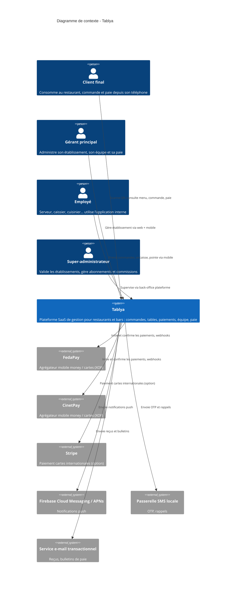

**Explication.** Quatre acteurs interagissent avec un seul système Tablya. Dépendances externes critiques : agrégateurs de paiement (FedaPay + CinetPay), canaux de notification. La couche d'orchestration de paiement isole les acteurs des fournisseurs.

## 1.2 Conteneurs (C4 niveau 2)

```mermaid
C4Container
    title Diagramme de conteneurs - Tablya

    Person(client, "Client final")
    Person(personnel, "Personnel établissement")
    Person(superadmin, "Super-administrateur")

    System_Boundary(tablya, "Tablya") {
        Container(appmobile, "Application mobile", "Flutter (Dart)", "Android/iOS : espace client + personnel, scan QR, commandes, pointage, KDS-lite")
        Container(webbo, "Back-office web", "Next.js / React / TypeScript", "Espace gérant et super-admin")
        Container(kds, "Écrans cuisine/caisse", "Tablette web", "KDS, plan de salle, caisse — mode sombre")

        Container(api, "API backend", "NestJS (Node.js/TypeScript)", "API REST + WebSocket Socket.IO, auth JWT/OAuth2, RBAC, multi-tenant")
        Container(svc_paiement, "Service paiement", "NestJS", "Orchestration FedaPay/CinetPay/Stripe, routage, webhooks, réconciliation, reversements")
        Container(svc_paie, "Service paie", "NestJS", "Bulletins PDF, calculs sociaux, virement groupé, double validation")
        Container(svc_notif, "Service notifications", "NestJS", "Push FCM/APNs, SMS, e-mail, notifications temps réel")
        Container(worker, "Workers asynchrones", "BullMQ sur Redis", "Webhooks, paie mensuelle, rappels, relances, exports")

        ContainerDb(pg, "Base de données", "PostgreSQL", "Données transactionnelles, RLS par tenant_id, full-text")
        ContainerDb(redis, "Cache / Files / Sessions", "Redis", "Sessions, cache menu, verrous de table, files BullMQ")
        ContainerDb(s3, "Stockage objets", "S3-compatible", "Photos menu, logos, PDF bulletins/reçus, exports")
        ContainerDb(search, "Moteur de recherche", "PostgreSQL FTS puis Meilisearch", "Recherche établissements et plats")
    }

    Rel(client, appmobile, "Utilise")
    Rel(personnel, appmobile, "Utilise")
    Rel(personnel, kds, "Utilise sur tablette")
    Rel(superadmin, webbo, "Utilise")
    Rel(personnel, webbo, "Utilise (gérant)")

    Rel(appmobile, api, "REST + WebSocket", "HTTPS/TLS 1.3")
    Rel(webbo, api, "REST + WebSocket", "HTTPS/TLS 1.3")
    Rel(kds, api, "REST + WebSocket", "HTTPS/TLS 1.3")

    Rel(api, pg, "SQL")
    Rel(api, redis, "Sessions, cache, verrous")
    Rel(api, s3, "URLs signées")
    Rel(api, search, "Requêtes de recherche")

    Rel(api, svc_paie, "Événements internes")
    Rel(api, svc_notif, "Événements internes")
    Rel(api, worker, "Enfile des tâches")

    Rel(svc_paiement, fedapay_ext, "API paiement + webhooks")
    Rel(svc_paiement, cinetpay_ext, "API paiement + webhooks")

    Rel(worker, pg, "SQL")
    Rel(worker, redis, "Consomme les files")
    Rel(worker, s3, "Génère PDF/exports")
    Rel(worker, svc_notif, "Déclenche envois")
    Rel(svc_paie, s3, "Stocke bulletins PDF")

    UpdateElementStyle(tablya, $bgColor="lightblue", $fontColor="black")
```

**Explication.** Trois fronts ne parlent qu'à l'API NestJS. Quatre services spécialisés isolent les domaines critiques : paiement, paie, notifications, workers. PostgreSQL+RLS = source de vérité ; Redis = sessions/cache/verrous/files ; S3 = médias et PDF. Recherche : PostgreSQL FTS, bascule Meilisearch si volume.

## 1.3 Cas d'utilisation par acteur

```mermaid
flowchart LR
    subgraph Acteurs
        SA[Super-administrateur]
        G[Gérant principal]
        E[Employé]
        C[Client final]
    end

    subgraph Tablya
        subgraph ModuleA["A - Établissements"]
            A1[Inscrire un établissement]
            A2[Valider / rejeter KYC]
            A3[Provisionner espace tenant]
            A4[Gérer multi-sites]
            A6[Gérer abonnement SaaS]
        end
        subgraph ModuleB["B - Espace client"]
            B1[Compte OTP / social]
            B2[Rechercher établissements]
            B3[Consulter menu]
            B4[Panier & commande]
            B5[Réserver une table]
            B6[Scanner QR place]
            B7[Payer / partager / pourboire]
            B8[Suivre commande]
            B9[Historique & avis]
            B10[Fidélité]
        end
        subgraph ModuleC["C - Plan de salle"]
            C1[Éditeur visuel plan de salle]
            C2[Numérotation unique places]
            C3[Attributs place]
            C5[QR par place]
            C6[Réservations & liste attente]
            C7[Fusion / transfert tables]
            C8[Dashboard occupation]
        end
        subgraph ModuleD["D - Catalogue & POS"]
            D1[Catalogue produits]
            D2[Stocks & recettes]
            D3[Prise de commande]
            D4[KDS & impression tickets]
            D5[Caisse & clôture]
            D6[Facturation fiscale]
            D7[Mode hors ligne]
        end
        subgraph ModuleEF["E-F - Paiement & Employés"]
            E1[Initier paiement]
            E2[Routage fournisseur]
            E3[Cycle transaction]
            E5[Reversement & commission]
            E7[Réconciliation]
            F1[Inviter employé]
            F2[Rôles RBAC]
            F3[Fiche employé]
            F4[Plannings]
            F5[Pointage]
            F6[Perf. employés]
        end
        subgraph ModuleGH["G-H - Paie & Pilotage"]
            G2[Calcul paie mensuelle]
            G3[Bulletins PDF]
            G4[Virement groupé salaires]
            H1[Dashboard gérant]
            H2[Rapports exportables]
            H3[Marketing & promos]
            H4[Gestion avis]
        end
        subgraph ModuleI["I - Super-admin"]
            I1[Supervision établissements]
            I2[Facturation SaaS]
            I3[Supervision transactions]
            I4[Métriques & alertes]
        end
    end

    SA --> A2 & A6 & I1 & I2 & I3 & I4
    G --> A1 & A4 & A6 & C1 & C2 & C5 & C6 & C7 & D1 & D2 & D5 & D6 & E5 & F1 & F2 & F3 & F4 & G4 & H1 & H2 & H3 & H4 & B10
    E --> D3 & D5 & D7 & C8 & F5 & F6
    C --> B1 & B2 & B3 & B4 & B5 & B6 & B7 & B8 & B9
```

**Explication.** Le super-admin couvre A (validation), I (supervision), facturation SaaS. Le gérant a le périmètre le plus large. L'employé est cantonné aux opérations terrain. Le client n'accède qu'au module B. Le RBAC (F) raffine ces périmètres au niveau permission.

## 1.4 Modèle de données (ERD)

Conventions : `id` UUID v7, `tenant_id` sur toutes les tables métier, montants `bigint` centimes XOF, `timestamptz`.

```mermaid
erDiagram
    ETABLISSEMENT ||--o{ UTILISATEUR : "possède"
    ETABLISSEMENT ||--o{ EMPLOYE : "emploie"
    ETABLISSEMENT ||--o{ ZONE : "définit"
    ETABLISSEMENT ||--o{ PLACE : "numérote"
    ETABLISSEMENT ||--o{ CATEGORIE : "catalogue"
    ETABLISSEMENT ||--o{ PRODUIT : "vend"
    ETABLISSEMENT ||--o{ COMMANDE : "reçoit"
    ETABLISSEMENT ||--o{ PORTEMONNAIE : "encaisse sur"
    ETABLISSEMENT ||--o{ ABONNEMENT : "souscrit"
    ETABLISSEMENT ||--o{ FOURNISSEUR : "achète chez"
    GROUPE ||--o{ ETABLISSEMENT : "regroupe (multi-sites)"

    ROLE ||--o{ UTILISATEUR : "attribué à"
    ROLE ||--o{ ROLE_PERMISSION : "possède"
    PERMISSION ||--o{ ROLE_PERMISSION : "décrit"

    PLACE ||--o{ RESERVATION : "réservée par"
    PLACE ||--o{ COMMANDE : "accueille"
    CATEGORIE ||--o{ PRODUIT : "contient"
    PRODUIT ||--o{ VARIANTE : "décline"
    PRODUIT ||--o{ LIGNE_COMMANDE : "commandé via"
    COMMANDE ||--o{ LIGNE_COMMANDE : "comporte"
    COMMANDE ||--o{ TRANSACTION : "réglée par"
    COMMANDE ||--o{ PARTAGE_PAIEMENT : "partagée en"
    TRANSACTION ||--o{ PARTAGE_PAIEMENT : "répartie en"
    PORTEMONNAIE ||--o{ TRANSACTION : "centralise"
    PORTEMONNAIE ||--o{ REVERSEMENT : "reverse vers"
    EMPLOYE ||--o{ POINTAGE : "pointe"
    EMPLOYE ||--o{ PLANNING : "planifié"
    EMPLOYE ||--o{ BULLETIN_PAIE : "reçoit"
    BULLETIN_PAIE ||--o{ PAIEMENT_SALAIRE : "réglé par"
    FOURNISSEUR ||--o{ STOCK : "approvisionne"
    PRODUIT ||--o{ STOCK : "stocké en"
    CLIENT ||--o{ COMMANDE : "passe"
    CLIENT ||--o{ RESERVATION : "réserve"
    CLIENT ||--o{ AVIS : "laisse"
    CLIENT ||--o{ FIDELITE : "cumule"

    ETABLISSEMENT {
        uuid id PK
        uuid tenant_id UK "uuid public du tenant"
        uuid groupe_id FK
        string raison_sociale
        string rccm
        string nif
        string slug UK
        string statut "en_attente|actif|suspendu|rejete"
        string devise "XOF"
        string langues "fr,en"
        jsonb charte_graphique
        jsonb horaires
        timestamptz created_at
    }

    GROUPE {
        uuid id PK
        string nom
        uuid tenant_id
    }

    UTILISATEUR {
        uuid id PK
        uuid tenant_id
        uuid etablissement_id FK
        uuid role_id FK
        string email
        string telephone
        string mot_de_passe_hash "Argon2id"
        boolean mfa_actif
        boolean email_verifie
        timestamptz created_at
    }

    ROLE {
        uuid id PK
        uuid tenant_id "null = rôle système"
        string code "gerant|serveur|caissier|cuisinier|..."
        string nom
        boolean systeme
    }

    PERMISSION {
        uuid id PK
        string code "module.action ex: commande.annuler"
        string description
    }

    ROLE_PERMISSION {
        uuid role_id PK,FK
        uuid permission_id PK,FK
        uuid tenant_id
    }

    EMPLOYE {
        uuid id PK
        uuid tenant_id
        uuid etablissement_id FK
        string nom
        string prenom
        string poste
        string telephone
        string coordonnee_paiement "chiffré"
        bigint salaire_base_centimes
        string statut_contrat
        date date_embauche
        uuid utilisateur_id FK
    }

    CLIENT {
        uuid id PK
        string telephone UK "identité globale"
        string email
        string nom
        string langue_preferee
        string niveau_fidelite
        uuid tenant_id "dernier tenant visité"
    }

    ZONE {
        uuid id PK
        uuid tenant_id
        uuid etablissement_id FK
        string nom "salle|terrasse|vip|bar"
        int capacite_defaut
        boolean active
    }

    PLACE {
        uuid id PK
        uuid tenant_id
        uuid etablissement_id FK
        uuid zone_id FK
        string numero UK "ETAB-ZONE-NUMERO ex LOME01-TER-014"
        int capacite
        string type "table|comptoir|canape|loge"
        string statut "libre|reservee|occupee|addition|nettoyage|hors_service"
        uuid commande_active_id FK
        string qr_token UK
        timestamptz updated_at
    }

    RESERVATION {
        uuid id PK
        uuid tenant_id
        uuid etablissement_id FK
        uuid place_id FK
        uuid client_id FK
        timestamptz creneau_debut
        timestamptz creneau_fin
        int nb_personnes
        string statut "confirmee|annulee|no_show|honoree"
    }

    CATEGORIE {
        uuid id PK
        uuid tenant_id
        uuid etablissement_id FK
        string nom
        int ordre
        boolean active
    }

    PRODUIT {
        uuid id PK
        uuid tenant_id
        uuid etablissement_id FK
        uuid categorie_id FK
        string nom
        string description
        string photo_url
        jsonb allergenes
        boolean disponible
        jsonb prix_par_plage "happy hour"
        boolean menu_compose
    }

    VARIANTE {
        uuid id PK
        uuid tenant_id
        uuid produit_id FK
        string nom
        bigint prix_centimes
    }

    COMMANDE {
        uuid id PK
        uuid tenant_id
        uuid etablissement_id FK
        uuid place_id FK
        uuid client_id FK
        uuid serveur_id FK
        string type "sur_place|emporter|livraison|precommande"
        string statut "recue|en_preparation|prete|servie|cloturee|annulee"
        string mode_paiement_prevu
        bigint total_centimes
        uuid idempotency_key UK
        jsonb metadata_hors_ligne
        timestamptz created_at
        timestamptz updated_at
    }

    LIGNE_COMMANDE {
        uuid id PK
        uuid tenant_id
        uuid commande_id FK
        uuid produit_id FK
        uuid variante_id FK
        int quantite
        bigint prix_unitaire_centimes
        bigint total_centimes
        jsonb supplements
        string statut "en_attente|envoye_cuisine|en_cours|pret|serve"
        string poste_cible "cuisine|bar|caisse"
        uuid parent_ligne_id FK
    }

    TRANSACTION {
        uuid id PK
        uuid tenant_id
        uuid etablissement_id FK
        uuid commande_id FK
        uuid portefeuille_id FK
        string fournisseur "fedapay|cinetpay|stripe|especes|virement"
        string type "paiement|refund|payout|abonnement"
        string reference_externe UK
        string statut "initiee|en_attente|reussie|echouee|expiree|annulee|partiellement_payee|remboursee_partiellement|remboursee"
        bigint montant_centimes
        string devise "XOF"
        bigint commission_plateforme_centimes
        bigint frais_fournisseur_centimes
        bigint net_etablissement_centimes
        string idempotency_key UK
        jsonb reponse_fournisseur
        timestamptz created_at
        timestamptz confirmed_at
    }

    PARTAGE_PAIEMENT {
        uuid id PK
        uuid tenant_id
        uuid transaction_id FK
        string libelle "convive_1..."
        bigint montant_centimes
        string statut "en_attente|reussi|echoue|rembourse"
        string reference_externe
    }

    PORTEMONNAIE {
        uuid id PK
        uuid tenant_id
        uuid etablissement_id FK UK
        bigint solde_centimes
        string devise "XOF"
        timestamptz updated_at
    }

    REVERSEMENT {
        uuid id PK
        uuid tenant_id
        uuid portefeuille_id FK
        bigint montant_centimes
        string statut "planifie|en_cours|reussi|echoue"
        string mode "instantane|lot"
        string destination "mobile_money|banque"
        string reference_externe
        timestamptz execute_at
        timestamptz completed_at
    }

    POINTAGE {
        uuid id PK
        uuid tenant_id
        uuid employe_id FK
        uuid utilisateur_id FK
        timestamptz heure_arrivee
        timestamptz heure_depart
        string methode "pin|qr|gps"
        string statut "present|absent|retard"
        uuid planning_id FK
    }

    PLANNING {
        uuid id PK
        uuid tenant_id
        uuid employe_id FK
        date jour
        time debut
        time fin
        string poste
        string statut
    }

    BULLETIN_PAIE {
        uuid id PK
        uuid tenant_id
        uuid employe_id FK
        int periode_annee
        int periode_mois
        bigint brut_centimes
        bigint net_centimes
        bigint cotisations_centimes
        bigint impots_centimes
        bigint primes_centimes
        bigint retenues_centimes
        bigint heures_sup_centimes
        string statut "brouillon|valide|approuve|paye|annule"
        string pdf_url
        uuid approved_by FK
        timestamptz created_at
    }

    PAIEMENT_SALAIRE {
        uuid id PK
        uuid tenant_id
        uuid bulletin_id FK
        uuid transaction_id FK
        bigint montant_centimes
        string statut "planifie|en_cours|reussi|echoue|a_rejouer"
        string reference_externe
        timestamptz paid_at
    }

    STOCK {
        uuid id PK
        uuid tenant_id
        uuid etablissement_id FK
        uuid produit_id FK
        uuid fournisseur_id FK
        bigint quantite
        bigint seuil_alerte
        string unite
        timestamptz updated_at
    }

    FOURNISSEUR {
        uuid id PK
        uuid tenant_id
        uuid etablissement_id FK
        string nom
        string coordonnees
        string telephone
    }

    AVIS {
        uuid id PK
        uuid tenant_id
        uuid etablissement_id FK
        uuid client_id FK
        uuid commande_id FK
        int note "1-5"
        string commentaire
        string reponse_gerant
        timestamptz created_at
    }

    ABONNEMENT {
        uuid id PK
        uuid tenant_id
        uuid etablissement_id FK
        string plan "starter|pro|entreprise"
        string statut "essai|actif|impaye|suspendu"
        date debut
        date fin
        bigint montant_centimes
        int periode "mensuel|annuel"
    }

    FIDELITE {
        uuid id PK
        uuid tenant_id
        uuid client_id FK
        uuid etablissement_id FK
        int points
        string niveau
        timestamptz updated_at
    }

    PAYMENT_EVENT {
        uuid id PK
        uuid tenant_id
        uuid transaction_id FK
        string fournisseur "fedapay|cinetpay|stripe"
        string type "initiate|webhook|refund|payout|reconcile"
        string reference_externe
        string payload_hash "SHA-256"
        string statut "received|processed|duplicate|rejected|error"
        smallint http_status
        int duree_ms
        string erreur_code
        timestamptz created_at
    }

    AUDIT_LOG {
        uuid id PK
        uuid tenant_id
        uuid utilisateur_id FK
        uuid etablissement_id FK
        string action "commande.annuler|prix.modifier|..."
        string entite_type
        uuid entite_id
        jsonb avant
        jsonb apres
        string motif
        string ip
        string request_id
        timestamptz created_at "append-only"
    }
```

**Points clés.**

- `PLACE.numero` : `UNIQUE (tenant_id, numero)` ; généré serveur depuis `slug` + zone + compteur ; stocké pour garantir l'unicité.
- `TRANSACTION` : `idempotency_key` + `reference_externe` uniques → anti double encaissement et webhook rejouable.
- `COMMANDE.idempotency_key` unique par tenant → rejets des doubles soumissions / sync hors ligne.
- `PORTEMONNAIE.solde_centimes` = cache ; source de vérité = ledger dérivé de `TRANSACTION`/`REVERSEMENT` (partie double).
- `AUDIT_LOG` append-only (trigger anti UPDATE/DELETE).
- `PAYMENT_EVENT` : dédoublonnage webhook via index unique `(fournisseur, reference_externe, type)` sur `processed`.

## 1.5 Séquence — Inscription et validation d'un établissement (A1–A3, A6)

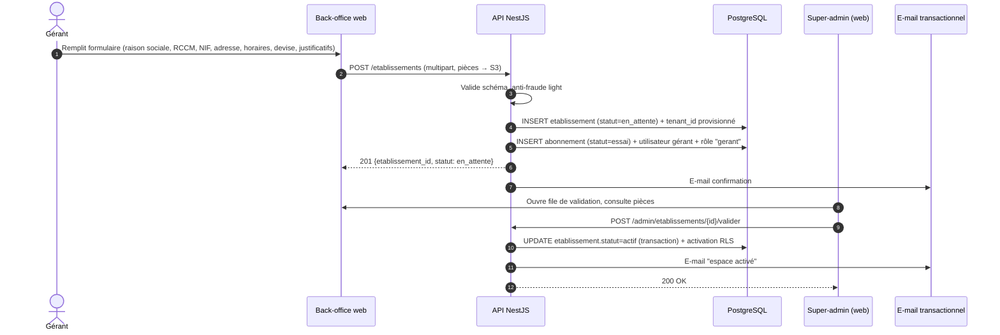

**Explication.** Le tenant (`tenant_id`+`slug`) est provisionné dès l'inscription, mais `en_attente` : rien n'est exposé côté client avant validation. Validation atomique ; rejet = motif audité.

## 1.6 Séquence — Scan QR et commande (B4, B6, D3, J)

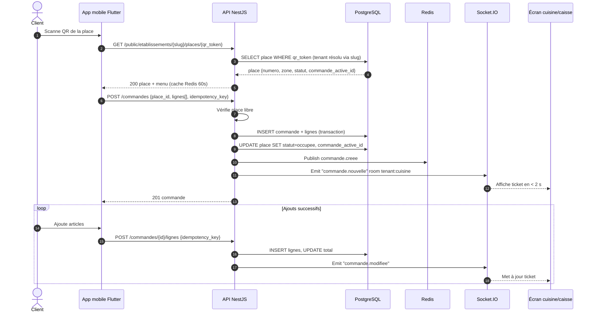

**Explication.** Le QR ne contient qu'un `qr_token` opaque : il résout le tenant via le `slug` — aucune fuite cross-tenant. Écritures idempotentes ; changements poussés en temps réel aux KDS/caisse (< 2 s exigence). Transition `libre → occupée` atomique dans la même transaction.

## 1.7 Séquence — Paiement mobile money + webhook (B7, E1–E4)

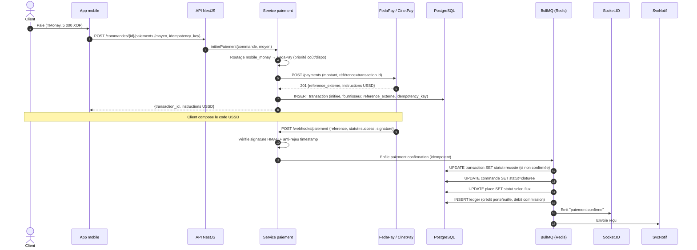

**Explication.** `reference_externe` généré par Tablya avant l'appel → réconciliation triviale. Le webhook n'est jamais traité en ligne : signature vérifiée puis déposé en BullMQ ; worker idempotent — webhook dupliqué = aucun effet de bord. Reversement comptabilisé dans le même job.

## 1.8 Séquence — Paiement fractionné (B7, E10)

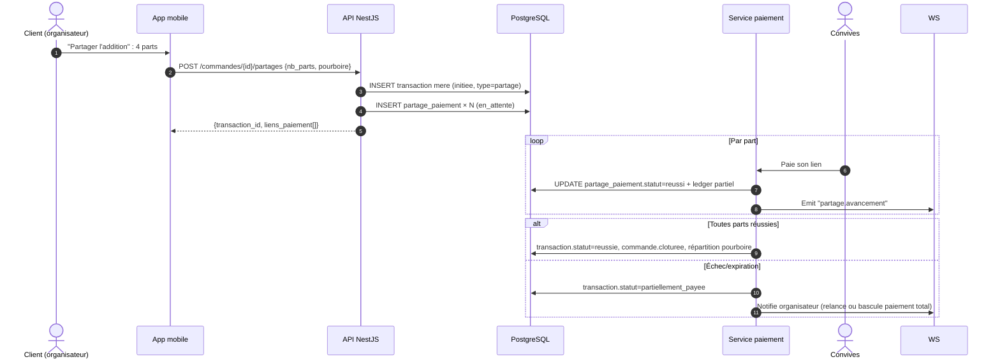

**Explication.** Transaction mère + N `partage_paiement`, chacun son `reference_externe`. Clôture à 100 % ; échec → `partiellement_payee` avec relance/bascule. Pourboire réparti entre employés via module paie.

## 1.9 Séquence — Remboursement (E3, I3)

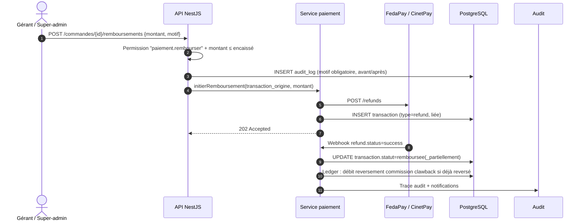

**Explication.** Motif + permission dédiée + audit snapshot obligatoire. Remboursement = transaction `refund` liée, jamais mutation de l'originale. Clawback de commission si reversement déjà exécuté.

## 1.10 Séquence — Paie mensuelle + virement groupé (G2–G5)

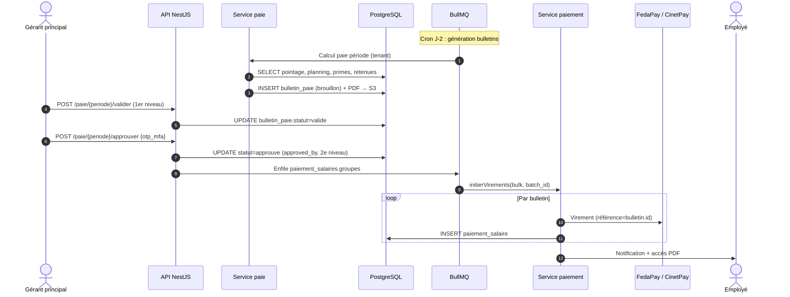

**Explication.** Workflow deux niveaux (préparation puis approbation MFA, `approved_by`). Calcul agrège pointage/plannings/HS/primes/retenues ; PDF serveur en S3. `paiement_salaire` idempotent par `bulletin_id`, rejouable (`a_rejouer`).

## 1.11 Séquence — Synchronisation hors ligne (D7)

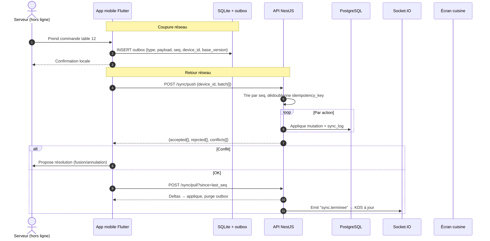

**Explication.** Outbox pattern : chaque action en SQLite avec `seq` monotone + `idempotency_key`. `/sync/push` rejoue le batch dédoublonné ; `/sync/pull` rapatrie les deltas. Conflits (ex. place prise) signalés avec résolution assistée.

## 1.12 États — Place / Table (C4)

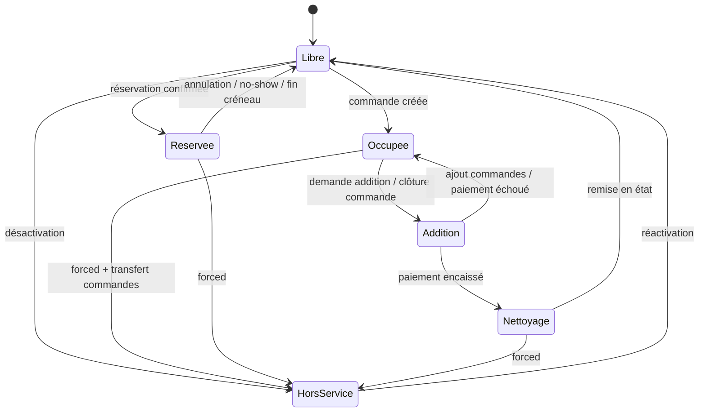

**Explication.** `Addition` = commande clôturée côté client, place physiquement occupée jusqu'au paiement. Chaque transition émise sur Socket.IO (room `tenant:{id}:salle`) pour le dashboard C8. `HorsService` forcé = motif + audit.

## 1.13 États — Commande (D3–D5, B8)

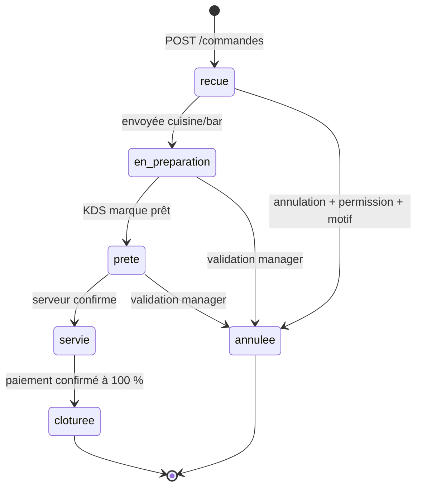

**Explication.** Annulations de plus en plus hiérarchisées avec l'avancement. `cloturee` uniquement sur confirmation paiement (webhook vérifié ou encaissement caisse). Historisée + audit pour annulations.

## 1.14 États — Transaction de paiement (E3, E7)

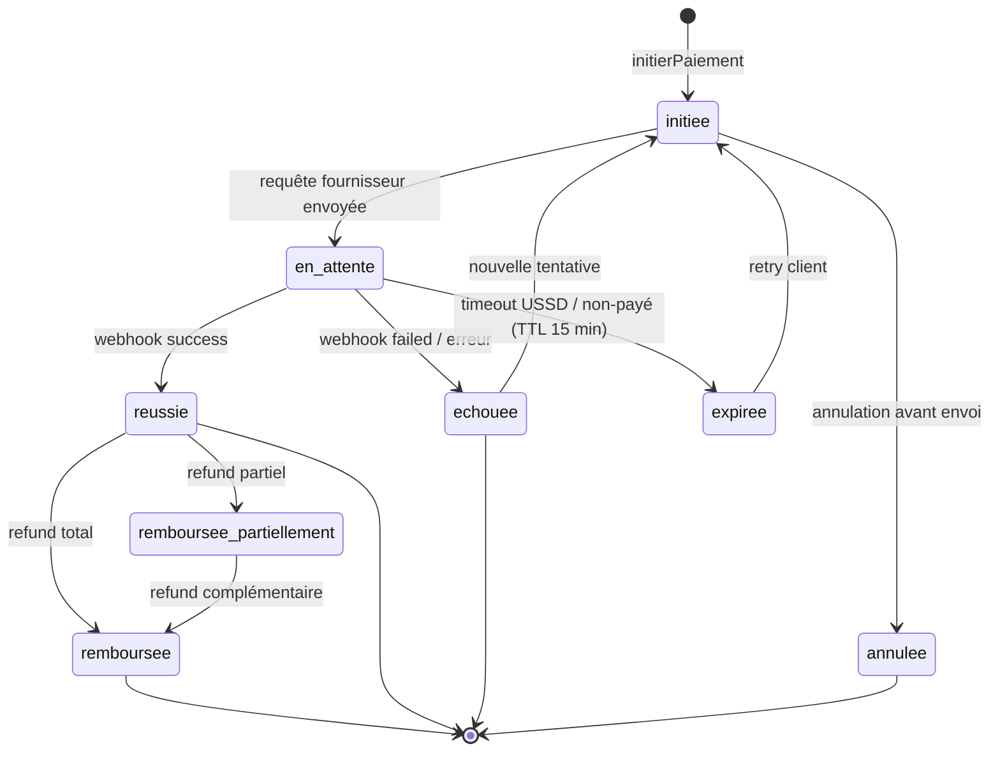

**Explication.** Alignée sur les cycles agrégateurs. `expiree` couvre le non- USSD (TTL court). Transitions uniquement via webhooks vérifiés ou opérations idempotentes. `remboursee*` terminal + clawback commission si déjà reversé.

## 1.15 États — Bulletin de paie (G2–G5)

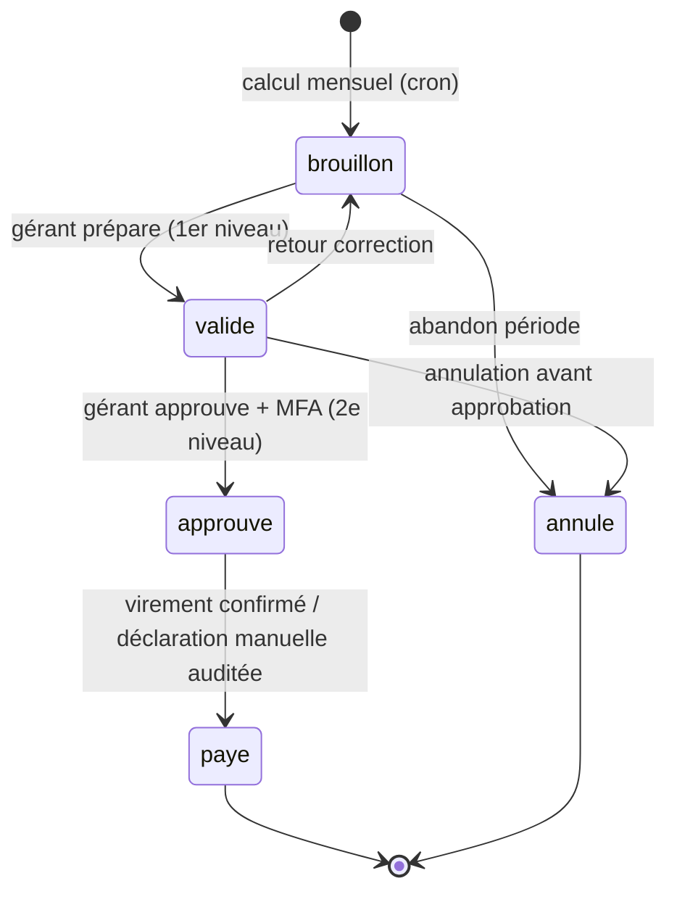

**Explication.** `valide` = 1ʳᵉ validation (préparation), `approuve` = 2ᵉ (MFA, `approved_by`). `paye` sur confirmation `paiement_salaire` ou déclaration manuelle auditée (espèces). Retours arrière uniquement avant approbation.

## 1.16 Flux réconciliation et reversement (E5–E8)

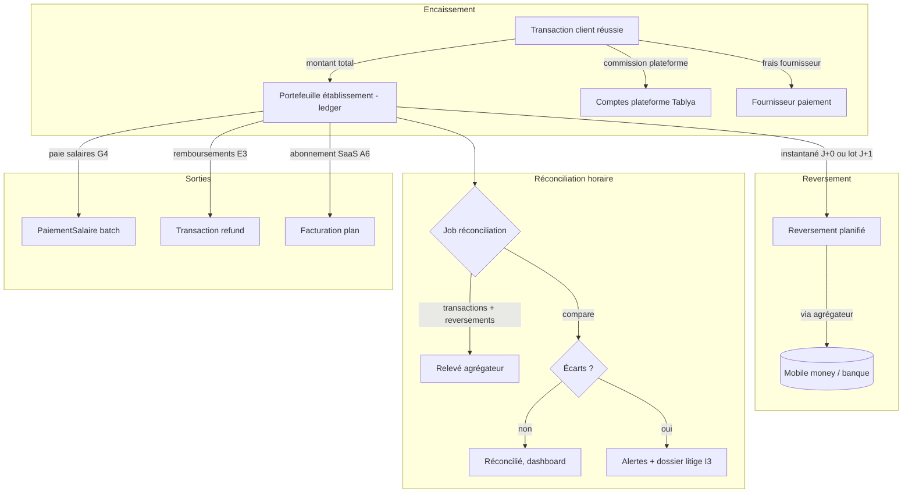

**Explication.** Chaque transaction alimente trois flux : portefeuille net, commission plateforme, frais fournisseur. Reversement J+0 (option) ou J+1 par défaut. Réconciliation horaire ledger ↔ relevés fournisseurs ; écart = dossier litige super-admin. Sorties sensibles (salaires, refunds, abonnements) débitent le même portefeuille.
